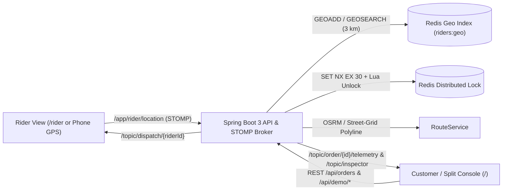

# SwiftFleet — Real-Time Delivery Fleet, Redis Geo & Live GPS Tracker

SwiftFleet is a last-mile hyperlocal delivery dispatch & live telemetry platform built with **Java 17 + Spring Boot 3 (STOMP WebSockets + Redis Geo/Distributed Locks)** and **React 19 + TypeScript + Vite + Leaflet (OpenStreetMap)**.

Together with **WhatsCart AI** (conversational ordering) and **DRC Store** (fulfillment), SwiftFleet completes an end-to-end Zepto/Blinkit-style hyperlocal commerce trilogy:

```
WhatsCart AI (Order)  ──▶  DRC Store (Fulfillment)  ──▶  SwiftFleet (Last-Mile Logistics)
```

---

## System Architecture



---

## Resume-Ready Bullet Points

- **Engineered a real-time hyperlocal dispatch engine** (`Java 17`, `Spring Boot 3`, `STOMP WebSockets`, `Redis`) using `GEOADD` and `GEOSEARCH` to match online riders within a 3 km radius in sub-millisecond time.
- **Eliminated concurrent order double-booking** with an atomic Redis distributed lock (`SET NX EX`) and Lua-guarded unlock script, verified under multi-threaded `CountDownLatch` race-condition tests (`200 OK` vs `409 Conflict`).
- **Built live GPS telemetry and fraud-proof delivery verification**, streaming street-polyline coordinates over STOMP WebSockets to a `React` + `TypeScript` + `Leaflet` split-screen console with a 150 m geofence guard and rate-limited 4-digit OTP handshake.

---

## Key Engineering Highlights

1. **Sub-Millisecond Geospatial Rider Matching (`Redis GEOADD` / `GEOSEARCH`)**
   - Online riders update a Redis Geo index (`riders:geo`).
   - Incoming orders query `GEOSEARCH riders:geo FROMLONLAT <lng> <lat> BYRADIUS 3 km ASC` and send targeted STOMP alerts (`/topic/dispatch/{riderId}`) only to nearby `IDLE` riders.

2. **Concurrency-Safe Dispatch Lock (`SET NX EX` + Lua Unlock)**
   - Guards order acceptance with an atomic distributed lock (`SET lock:order:{orderId} {riderId} NX EX 30`).
   - If two riders tap **Accept** at the exact same millisecond, Rider 1 receives `200 OK` and Rider 2 receives `409 Conflict`.
   - Built-in **Simulate Race Condition** button launches two `CountDownLatch`-synchronized threads to demonstrate zero double-booking live.

3. **Live Bidirectional STOMP WebSockets + Road-Snapped Simulation**
   - Riders stream GPS frames via STOMP (`/app/rider/location`) or REST (`/api/riders/{id}/location`), updating `riders:geo`, recalculating Haversine ETA & remaining distance, and broadcasting to `/topic/order/{id}/telemetry`.
   - Uses **Leaflet + OpenStreetMap** + **OSRM** street polylines (with an automatic street-grid polyline fallback when offline) — **$0 API cost**.

4. **150m Geofence Guard + 4-Digit OTP Handshake**
   - Prevents riders from marking deliveries complete until inside the configured drop-off geofence (`150 m` default) and entering the exact 4-digit OTP (with attempt rate limiting).

5. **Split-Screen Interview Mode & Live Architecture Inspector**
   - `/` renders the mobile-frame Rider App alongside the Live Map, Customer OTP & Chaos Lab, and a real-time **Redis & STOMP Inspector** logging commands and latencies.
   - `/rider` renders a standalone mobile view — open it on a phone browser to stream real **HTML5 Geolocation (`watchPosition`)** directly to your laptop map.

---

## Running Locally

### Option 1: Full Stack with Docker Compose (Recommended — Live Redis 7)
```bash
docker compose up --build
```
- Frontend: `http://localhost:3005`
- Mobile Rider View: `http://localhost:3005/rider`
- Backend API & Swagger: `http://localhost:8085/swagger-ui.html`

### Option 2: Dev Mode (`mvn spring-boot:run` + `npm run dev`)
*(Automatically uses live Redis if running on `localhost:6379`, or cleanly falls back to `IN_MEMORY_FALLBACK` mode if Docker/Redis is stopped.)*

```powershell
# Or run .\start.ps1 on Windows
cd backend && mvn spring-boot:run
cd frontend && npm install && npm run dev
```
- Split-Screen Demo: `http://localhost:5173`
- Mobile Rider View: `http://localhost:5173/rider`

---

## $0 Cloud Deployment Guide

| Layer | Free Service | Configuration |
| :--- | :--- | :--- |
| **Redis** | [Upstash Redis](https://upstash.com/) *(Free Tier)* | Copy TLS URL `rediss://default:<token>@<host>:<port>` into `REDIS_URL` |
| **Backend** | [Render](https://render.com/) *(Docker Web Service, Free)* | Uses `backend/Dockerfile` (`-Xmx300m -XX:+UseSerialGC`), set `REDIS_URL`, `FLEET_STORE_MODE=redis`, `CORS_ALLOWED_ORIGINS=https://your-app.vercel.app` |
| **Frontend** | [Vercel](https://vercel.com/) *(Free)* | Root dir `frontend` (includes `vercel.json` SPA rewrite for `/rider`), set `VITE_API_BASE_URL=https://your-api.onrender.com` and `VITE_WS_URL=wss://your-api.onrender.com/ws-swiftfleet` |

---

## Tests

```bash
# Backend unit, concurrency race-condition, geofence/OTP, Redis Geo/Lua mock, and MockMvc tests
cd backend && mvn test

# Frontend TypeScript check, Vitest unit tests, and production Vite bundle
cd frontend && npm run typecheck && npm test && npm run build
```

